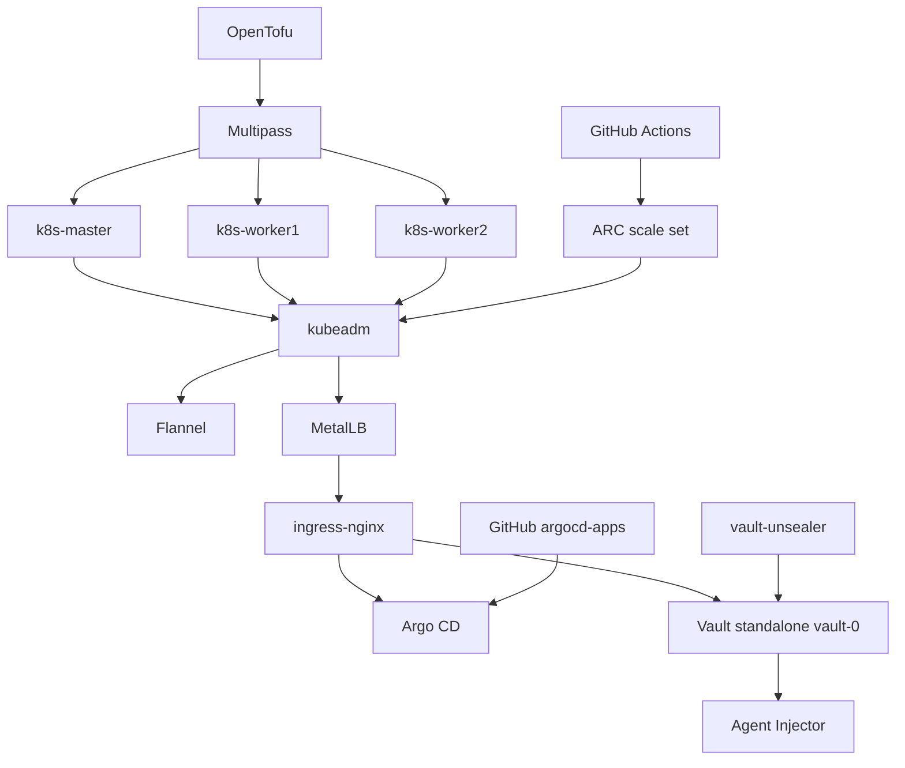

# k8s-platform

Учебный локальный Kubernetes на Multipass: kubeadm, MetalLB, Argo CD, Vault standalone и OpenTofu.

## Что показывает проект

Это стенд платформы, а не только список команд. Два пути ведут к одному кластеру: пошаговые скрипты в `scripts/` и повторяемая установка через OpenTofu (`opentofu/`, скрипты в `scripts-tofu/`). Каталог `terraform/` - ранний эксперимент, он создает только виртуальные машины.

На стенде видно:

- кластер `kubeadm` из трех VM (`k8s-master`, `k8s-worker1`, `k8s-worker2`);
- сеть: `Flannel` для Pod, `MetalLB` для `LoadBalancer`, `ingress-nginx` для имен `argocd.local` и `vault.local`;
- GitOps: `Argo CD` смотрит репозиторий `argocd-apps` и Application `nginx`; автосинхронизация выключена, синхронизация ручная;
- секреты: один инстанс HashiCorp Vault (не HA), file storage на PVC, Agent Injector и Kubernetes auth;
- доступ: учебный RBAC и проверки `kubectl auth can-i`;
- CI: GitHub Actions через Actions Runner Controller. Раннеры зарегистрированы на репозиторий `github-actions-pipeline`, не на GitLab.

Что на этом разбирается:

- поднять control plane и присоединить worker-ноды;
- разделить Pod-сеть, внешний IP и Ingress;
- держать desired state приложения в Git и доставлять его через `Argo CD`;
- отдать секрету поду через ServiceAccount, не копируя пароль в обычный Secret;
- отличить учебный unseal одного инстанса от production auto-unseal и Raft HA;
- повторить установку кодом OpenTofu, а не только ручным запуском скриптов.

## Архитектура

`vault-unsealer` - отдельный Deployment. После рестарта пода он вызывает `vault operator unseal`. Это не облачный auto-unseal.

## Security considerations

Стенд лабораторный. Так устроены секреты и состояние:

- State OpenTofu локальный. `*.tfstate`, `*.tfstate.backup` и `.terraform/` лежат в `.gitignore` и в репозиторий не входят.
- SSH-ключ `~/.ssh/id_rsa_tofu` и PAT раннеров `~/.arc-token` остаются в WSL home, вне Git. OpenTofu читает их в момент apply. Файл `opentofu/join-command.txt` содержит команду входа в кластер, его тоже не коммитят.
- Vault - один Pod `vault-0`, storage `file` на PVC `local-path`. Raft и второго узла нет: single-instance, без HA.
- Init создает один ключ Shamir. Ключ и root token пишутся в Secret `vault-init` в том же кластере. Deployment `vault-unsealer` после рестарта повторяет `operator unseal`. Это автоматизация Shamir, не auto-unseal HashiCorp через KMS, GCP KMS, Azure Key Vault или Transit. Замок и ключ лежат рядом. Для лаборатории так и задумано.
- TLS на API Vault нет. Вход в `Argo CD` CLI идет с `--insecure`.

В проде вместо этого были бы: несколько реплик на Raft, TLS, auto-unseal ключом вне кластера, root token не в etcd, удаленный state с блокировкой и выдача PAT из секрет-хранилища CI, а не с диска рабочей станции.

Подробности Vault: `docs/terraform/08-vault.md` и `docs/terraform/09-vault-injector.md`.

## Что уже собрано

- виртуальные машины control plane и worker-нод;
- Kubernetes через `kubeadm` и сетевой плагин `Flannel`;
- `MetalLB` и `NGINX Ingress Controller`;
- `Argo CD`, UI на `argocd.local`, репозиторий и Application `nginx`;
- учебный RBAC;
- HashiCorp Vault: standalone, file PVC, учебный unseal, Agent Injector, Kubernetes auth;
- Actions Runner Controller (Helm, scale set на репозиторий GitHub);
- IaC: `opentofu/` для VM, Kubernetes и платформы; `terraform/` только для VM.

Дальше по смыслу стенда, не как обязательный хвост:

- workflow в `github-actions-pipeline`, который меняет манифест, и включенная синхронизация `Argo CD` (сейчас `sync-policy none`, ARC уже стоит);
- Vault ближе к проду: Raft HA, TLS, auto-unseal через KMS или Transit;
- параметры OpenTofu вынести из захардкоженного `main.tf`.

GitLab в этом репозитории не используется. CI-путь - GitHub Actions.

## Структура репозитория

- `scripts/` - пошаговые bash-скрипты развертывания и обслуживания;
- `scripts-tofu/` - скрипты, которые OpenTofu копирует внутрь VM;
- `opentofu/` - IaC для VM и установки Kubernetes;
- `terraform/` - ранний эксперимент: только создание VM;
- `manifests/` - Kubernetes-манифесты;
- `docs/steps/` - документация bash-пути: шаги `scripts/` и roadmap;
- `docs/terraform/` - документация IaC-пути: `opentofu/`, `terraform/`, `scripts-tofu/`.

## Bash-путь

1. `scripts/00-create-vms.sh` - создание виртуальных машин в `Multipass`.
2. `scripts/01-install-k8s.sh` - установка Kubernetes и инициализация кластера.
3. `scripts/02-install-flannel.sh` - установка сетевого плагина `Flannel`.
4. `scripts/03-install-metallb.sh` - установка `MetalLB` и создание IP-пула.
5. `scripts/04-install-argocd.sh` - установка `Argo CD`.
6. `scripts/05-install-ingress-controller.sh` - установка `NGINX Ingress Controller`.
7. `scripts/06-create-argocd-ingress.sh` - Ingress для UI `Argo CD`.
8. `scripts/07-setup-gitops.sh` - GitOps: репозиторий и Application в `Argo CD`.
9. `scripts/99-cleanup.sh` - очистка локального стенда.

Vault, RBAC и ARC на этом списке нет: их ставит OpenTofu (`docs/terraform/`).

## Документация

- `docs/steps/01-project-overview.md` - обзор проекта и текущего состояния;
- `docs/steps/02-current-state.md` - описание уже выполненных шагов;
- `docs/steps/03-roadmap.md` - roadmap следующих этапов настройки кластера;
- `docs/steps/04-install-argocd.md` - установка `Argo CD`;
- `docs/steps/05-install-ingress-controller.md` - установка Ingress-контроллера;
- `docs/steps/06-create-argocd-ingress.md` - Ingress для `Argo CD`;
- `docs/steps/07-setup-gitops.md` - настройка GitOps через `Argo CD` CLI.

Документация IaC:

- `docs/terraform/01-opentofu.md` - OpenTofu: VM, Kubernetes и Flannel;
- `docs/terraform/02-terraform-experiment.md` - ранний Terraform-черновик для VM;
- `docs/terraform/03-flannel.md` - установка Flannel через OpenTofu;
- `docs/terraform/04-argocd.md` - установка Argo CD через OpenTofu;
- `docs/terraform/05-gitops.md` - GitOps: репозиторий и Application;
- `docs/terraform/06-rbac.md` - RBAC через OpenTofu;
- `docs/terraform/07-test-rbac.md` - проверка RBAC через `kubectl auth can-i`;
- `docs/terraform/08-vault.md` - Vault standalone: один инстанс, file PVC, учебный unseal;
- `docs/terraform/09-vault-injector.md` - Kubernetes auth, политика и учебный Pod;
- `docs/terraform/10-arc.md` - Actions Runner Controller (Helm, PAT, scale set).
